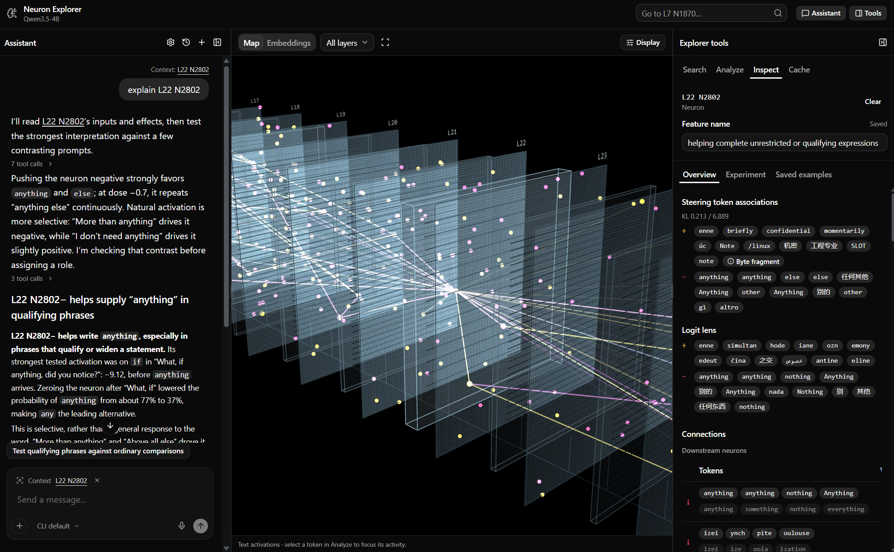

# neuron explorer

Steering-first neuron explorer for Qwen3.5-4B. Every MLP neuron in a layer is pushed up and down on a few prompts, every
rollout is kept, and the explorer lays the results out over a 3D view of the model.

## Explorer

    uv sync
    uv run python explorer/server.py        # http://localhost:8791

Loads Qwen3.5-4B locally on MPS, CUDA or CPU for steered chat and live analysis. Model weights download from
Hugging Face on first use; they are separate from the analysis caches shipped in `explorer/cache/`.
Sweep runs in `runs/` and per-layer stats in `stats/` supply rollout examples and rankings, produced by the sweep below.
The server is accessible only from this machine.

If you have a custom CUDA build of PyTorch, launch with your environment's Python
(`.venv/Scripts/python.exe explorer/server.py` on Windows), or use `uv run --no-sync`.
An ordinary `uv sync` can replace custom wheels.

- **map**: the model's layers in perspective, attention and MLP per layer, one point per neuron. Hover shows a neuron's
  steer lens and logit lens; click opens it; click a layer's label to view its sheet face-on. `writes` places
  neurons with similar down-projection columns next to each other.
- **attention heads**: click a head to inspect its q/k/v/o neuron roles. Analyze text to see which tokens it reads
  from and how strongly it writes. Full attention shows softmax weights; linear attention shows signed effective weights.
- **list**: units ranked by word-cluster mass against random-direction controls; `lens` searches the steer and logit
  lenses for a token, `fires` runs your text through the model and filters neurons by activation.
- **neuron**: steered rollouts per prompt and dose, a three-column multi-turn steered chat (−, 0, +), lens and
  connections, and a name.
- **embeddings**: UMAP of a layer's rollouts, coloured by neuron, prompt, dose or kind.
- **Assistant**: choose Codex or Claude to explore neurons, run experiments and control the map through shared MCP tools.

## Assistant

The optional Assistant requires an installed, signed-in CLI:

- **Codex:** Codex CLI 0.164.0 or newer; sign in with `codex login`.
- **Claude:** Claude Code CLI, installed and signed in.

Choose the provider in the Assistant header. Each provider keeps its own conversation, draft and attachments;
**Past chats** opens saved conversations. Wait for a reply to finish or press Stop before switching providers.
Qwen runs locally, while assistant messages, attachments and tool results go to the selected CLI's provider.

File access defaults to **Project only**; access to your home folder is opt-in. Every shell command requires
approval and runs with your OS account's permissions, including access outside its starting directory.
See the [usage guide](docs/usage.md#assistant-configuration) for configuration, attachments and history behavior.

## Other models

Compatible dense Qwen3.5 text backbones can use separate model/revision-specific caches and live Chat, subject to
available memory. MoE models, GGUF files and other architectures require additional support.

`explorer/cache_job.py` builds caches in the background with progress and pause/resume support. Each model needs
its own caches; the shipped 4B data stays separate. See [models and cache jobs](docs/usage.md#models-and-cache-jobs)
for commands and hardware considerations. Core cache builds do not include rollout sweeps or embeddings.

## Sweep

Runs on a CUDA 13 GPU pod with the steering fork of vLLM ([RhizoNymph/vllm](https://github.com/RhizoNymph/vllm)).

    bash sweep/setup_pod.sh                                   # fork, deps, model; writes /workspace/env.sh
    python sweep/neuron_stats.py --layers 22 --tokens 2000000 --out stats/q35-4b
    python sweep/steer_sweep.py --stats stats/q35-4b_L22.npz --design main_rel --dose-unit rel \
        --neurons all --random-controls 256 --run q35-4b-L22
    sweep/run_depth.sh "4 9 13 17" 384 64                     # random-subset sweep across several layers

`main_rel` doses are fractions of the median residual norm leaving the layer: {who, snake, orange} × {−0.7, +0.5, +0.8}
and {free} × {+3}, plus one unsteered baseline per prompt.

| script | output |
|---|---|
| `sweep/neuron_stats.py` | per-neuron activation extremes by sign regime, down columns, residual norms |
| `sweep/steer_sweep.py` | `runs/<run>.jsonl`: text, token ids, logprobs, top-k per step; optional activation captures |
| `sweep/rank.py` | `runs/<run>.units.jsonl`: distinctive words, cluster mass, percentile against controls |
| `sweep/steer_lens.py` | `stats/steer_lens_L{l}.npz`: next-token Δlogprob and KL for ±0.8 pushes on every neuron |
| `sweep/depth_report.py` | `runs/depth_report.json`: per-layer share of neurons above controls, coherence, top units |
| `sweep/shift.py` | word-shift score against controls, all words counted |
| `sweep/merge_runs.py` | joins sharded runs of one layer |
| `sweep/check_equivalence.py` | HF vs vLLM steering and capture agreement |
| `sweep/bench.py`, `sweep/peek.py` | throughput conditions; terminal views of a run |
| `explorer/build_embeddings.py` | `runs/<run>.umap.json` |
| `explorer/build_layout.py` | Model-specific `layout_writes.npz` or `layout_reads.npz`; default 4B uses `explorer/cache/` |
| `explorer/build_connections.py` | Model-specific `connections.npz`: each neuron's 24 strongest direct-path links up and down |
| `explorer/cache_job.py` | Resumable background builds of the core caches; see the [usage guide](docs/usage.md#models-and-cache-jobs) |
| `sweep/capture_prefill.py` | `captures/<run>.mlp_in.npy`: MLP input at the last prompt token at the run's capture layers, steered |

`research_log.md` holds the findings and reasoning; `NOTES.md` the source notes.

## Suggested future features

- **Saved neuron Chat:** reopen experiments after a reload and export conversations with their model and steering settings.
- **In-app model controls:** view download/loading status and explicitly download, start or unload the local model.
- **Faster CUDA Chat:** investigate CUDA-graph decoding, with numerical-parity tests before enabling it.

These are proposals, not implemented features or scheduled releases.

## Development

With Node.js and the development dependencies installed, run `python tests/run_checks.py` from your configured
Python environment. See the [development guide](docs/development.md) for setup, test coverage and known limitations,
the [usage guide](docs/usage.md) for advanced operation, and the [changelog](CHANGELOG.md) for release changes.

Based on [Lyra C's neuron explorer](https://github.com/lyramakesmusic/neuron-explorer).
