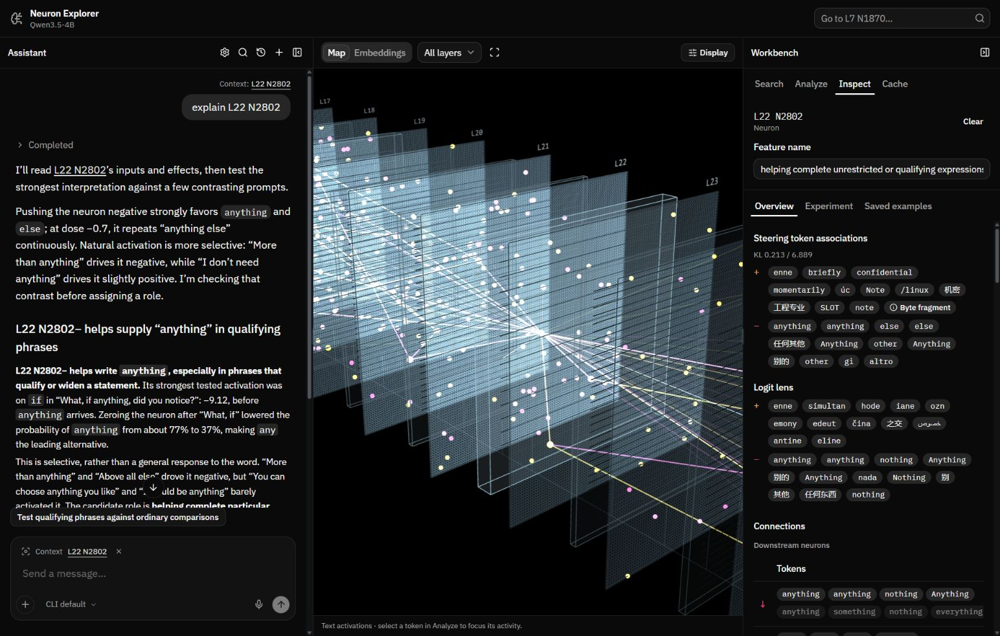

# Neuron Explorer

Explore Qwen3.5-4B through token associations, attention links, activations and steering experiments.
Inspect local-model behavior on a 3D map alongside a research assistant.



## Explorer

Requires Python 3.11+, [uv](https://docs.astral.sh/uv/) and Node.js 22.12+.
If you use a custom CUDA build of PyTorch, preserve your existing environment rather than running `uv sync`;
see [Python environments](docs/development.md#python-environments).

```sh
uv sync
npm ci
npm run build
uv run python explorer/server.py
```

Open [localhost:8791](http://localhost:8791). The server is accessible only from this machine.
Qwen runs locally on MPS, CUDA or CPU; model weights download from Hugging Face on first use.
The analysis caches in `explorer/cache/` are separate from the model weights.

Use the map to explore neurons and attention heads, search their token associations, analyze passages,
and compare baseline and steered generations. Saved rollout examples and rankings come from research sweeps.
The optional Assistant helps investigate neurons and circuits alongside the scientific tools.
See the [usage guide](docs/usage.md#working-in-the-explorer) for navigation and experiments.

## Assistant

Choose Codex or Claude in **Settings → Chat** from the top bar. Dependencies include their official SDKs and bundled runtimes.

- **Codex:** sign in with `codex login` if needed.
- **Claude:** configure [supported Agent SDK authentication](docs/usage.md#assistant-configuration), such as `ANTHROPIC_API_KEY`.

Qwen inference stays local; assistant messages, attachments and tool results go to the selected provider.
File access defaults to the project. Shell commands and existing-file overwrites require approval;
approved shell commands run with your OS account's permissions.

See [Assistant configuration](docs/usage.md#assistant-configuration) for authentication, model selection,
file access, attachments and saved conversations.

## Other models

Compatible dense Qwen3.5 text backbones can use their own model/revision-specific caches, subject to available memory.
MoE models, GGUF files and other architectures need additional support.
See [models and cache jobs](docs/usage.md#models-and-cache-jobs) for supported workflows and build commands.

## Research

- [Running sweeps](docs/usage.md#running-sweeps): calibration, rollout generation and analysis.
- [Research log](research_log.md): experimental observations and reasoning.
- [Historical source notes](docs/research/source-notes.md): original references and design inputs.

## Development

The frontend uses React, TypeScript and Vite; FastAPI serves the app and API on the same origin.
Run `npm run dev` to watch and rebuild the frontend while the Python server runs, then reload the browser.
Run `python tests/run_checks.py` from your configured Python environment for the release checks.

See the [development guide](docs/development.md) for architecture, testing and known limitations,
[assistant-ui integration](docs/assistant-ui.md) for chat component ownership, and the [changelog](CHANGELOG.md) for changes.

Fork of [Lyra C's neuron explorer](https://github.com/lyramakesmusic/neuron-explorer).
